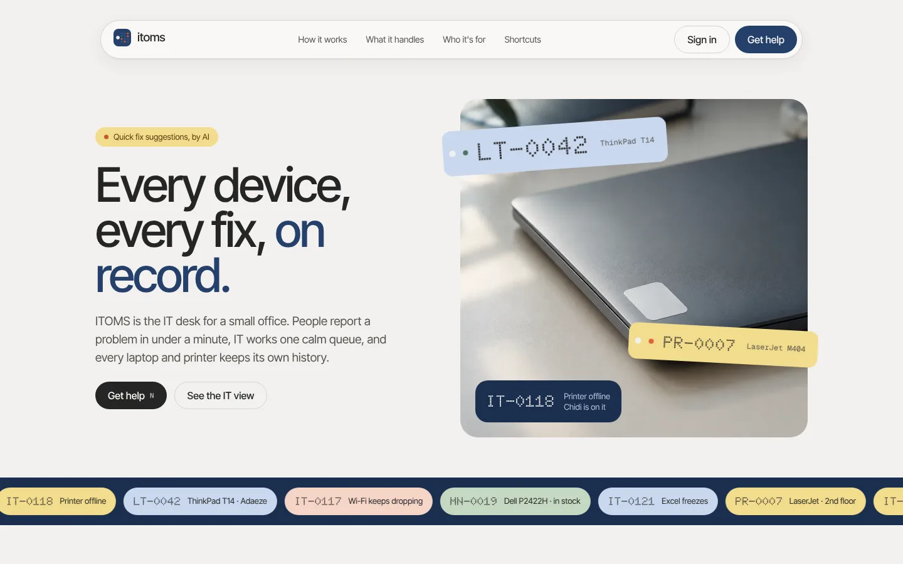
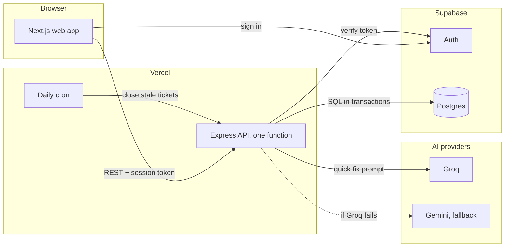

# ITOMS

An IT desk for a small office: employees report problems in under a minute, IT staff work one queue sorted by due time, and every laptop and printer keeps its own history.



**Live:** https://itoms-elisabeth-nnamanis-projects.vercel.app · **Case study:** [docs/case-study.md](docs/case-study.md) · **Try it:** the sign-in page has one-click demo accounts for each role.

## The problem

During an IT support internship at a 50-person office in Lagos, requests arrived by walking over, calling, or a WhatsApp message. Nobody could say which requests were waiting, who held which laptop, or how much a printer had cost in repairs. Many requests had a safe first step the employee could have tried alone.

## What it does

- Employees file a request in under a minute and follow it through four stages until they confirm the fix.
- An optional AI quick fix suggests safe first steps before a request is sent, and hands anything risky to IT.
- IT staff work one queue sorted by due time, from the keyboard: J and K move, Enter opens, A assigns, E escalates, Cmd+K finds anything.
- Every device has a tag, a holder, and a record of each repair and what it cost. Employees can propose corrections to their own devices, which IT approves.
- Administrators see what is late or escalated first, and decide who can do what.

## How it works



1. A person signs in with Supabase Auth. The web app keeps the session in cookies and calls the API from the server, so the token never reaches browser code.
2. The API verifies the token against Supabase's public keys and reads the person's role from the database on every request.
3. Rules live in the API and the database together: every ticket change and its history row are written in one transaction, and constraints guard what must never break.
4. The quick fix sends the problem to Groq (Gemini if Groq fails), validates the JSON answer, strips unsafe steps and stores the result.
5. Once a day, Vercel Cron closes tickets left resolved for three days.

More detail: [docs/architecture.md](docs/architecture.md). Every major choice has a decision record in [docs/decisions](docs/decisions).

## Engineering decisions

- **Postgres, with the rules in constraints.** Every screen joins tickets, people and devices, and every change writes history in the same transaction. A partial unique index allows one holder per device and one pending change request per device; a check constraint refuses a resolved ticket without a resolution. A document store was rejected for this shape of data ([ADR 008](docs/decisions/008-keep-supabase-postgres.md)).
- **A separate Express API.** It is the one place the business rules live and the natural entry point for an email-to-ticket webhook or an inventory agent later. It runs as one Vercel function, so there is no sleeping server before a demo ([ADR 007](docs/decisions/007-keep-express-api.md)).
- **Locks for updates, constraints for inserts.** Escalating or deciding a change request locks the row (`FOR UPDATE`), so two people cannot act on stale data. Duplicate requests are stopped by unique indexes, because a new row has nothing to lock yet.
- **Due times computed by the database.** A trigger sets `due_at` from the priority (urgent 4h, high 8h, medium 24h, low 72h), and "late" is computed in each query, so it is never stale and needs no background job ([ADR 010](docs/decisions/010-sla-and-escalation.md)).
- **One prompt, measured.** The quick fix is a single prompt with a validated JSON answer, no framework and no agent loop. Retrieval over past fixes waits until there are enough resolution notes to retrieve from ([ADR 012](docs/decisions/012-ai-pipeline.md)).

## AI quality

`pnpm eval` runs the quick fix against golden cases (should it help or hand over, and are its steps safe). The `eval` workflow runs it on GitHub for every change to the prompt or model and commits the results.

| Case set | Cases | Correct hand-over decision | Answers with an unsafe step removed | Errors | Latency p50 / p95 |
| -------- | ----- | -------------------------- | ----------------------------------- | ------ | ----------------- |
| Golden   | 32    | 31                         | 2                                   | 0      | 0.74 s / 2.2 s    |
| Unseen   | 15    | 14                         | 1                                   | 1      | 0.91 s / 2.2 s    |

Groq `openai/gpt-oss-20b`, about 1,100 tokens a request, free tier. Results in [apps/server/evals/results](apps/server/evals/results).

## Tech stack

- **Frontend:** Next.js 16 and React 19 with server actions, Tailwind CSS 4 with the ITOMS design tokens.
- **Backend:** Express 5 in TypeScript, zod schemas shared with the web app, plain SQL through `pg`.
- **Data and auth:** Postgres and Auth on Supabase.
- **AI:** Groq with Gemini as fallback, called directly over their OpenAI-compatible APIs.
- **Infra:** Vercel for both apps and the daily cron; GitHub Actions for lint, typecheck, API tests, end-to-end tests and the eval.
- **Tests:** Vitest and Supertest against a real Postgres (57 tests); Playwright for the three critical flows against a local Supabase stack.

## Run locally

Prerequisites: Node 22+, pnpm, and Docker for a local Supabase.

```bash
pnpm install
pnpm db:start                              # local Supabase in Docker
pnpm db:reset                              # migrations + demo data
cp .env.example apps/server/.env           # fill in from `pnpm exec supabase status`
cp apps/web/.env.example apps/web/.env.local
pnpm dev                                   # web on :3000, API on :4000
```

`apps/server/.env`

| Variable                         | Value                                                                                     |
| -------------------------------- | ----------------------------------------------------------------------------------------- |
| `DATABASE_URL`                   | local: `DB_URL` from `supabase status`; hosted: the transaction pooler string (port 6543) |
| `SUPABASE_URL`                   | `API_URL` from `supabase status`, or `https://<project-ref>.supabase.co`                  |
| `SUPABASE_JWT_SECRET`            | local stack only: `JWT_SECRET` from `supabase status`. Never set in production            |
| `WEB_ORIGIN`                     | `http://localhost:3000`                                                                   |
| `GROQ_API_KEY`, `GEMINI_API_KEY` | optional, for the AI quick fix                                                            |
| `SUPABASE_SERVICE_ROLE_KEY`      | optional, for inviting people                                                             |

`apps/web/.env.local`: `NEXT_PUBLIC_SUPABASE_URL`, `NEXT_PUBLIC_SUPABASE_PUBLISHABLE_KEY` and `API_URL=http://localhost:4000`.

Demo accounts (password `itoms-demo-2026` for all three; the administrator is read-only):

| Email                         | Role          |
| ----------------------------- | ------------- |
| `adaeze.okafor@itoms.example` | Employee      |
| `chidi.eze@itoms.example`     | IT staff      |
| `amaka.obi@itoms.example`     | Administrator |

## Checks

```bash
pnpm lint
pnpm typecheck
pnpm test                          # API tests against a local Postgres
pnpm --filter @itoms/web e2e       # Playwright; needs the local stack running
pnpm eval                          # needs GROQ_API_KEY
```

## Limitations and next steps

- Due times count wall-clock hours, so a ticket filed on Friday evening is late by Monday. Business hours are the next change once the office's hours are fixed.
- Nothing escalates or notifies on its own; Vercel's free cron runs once a day. At more volume, late tickets need email or chat notifications.
- The quick fix does not learn from past fixes yet. Resolution notes are now required, and retrieval over them is planned once about 200 exist.
- Demo data is not reset automatically; the demo administrator is read-only instead.

## Author

Elisabeth Nnamani · [hello@elisabethnnamani.dev](mailto:hello@elisabethnnamani.dev) · [LinkedIn](https://linkedin.com/in/elisabethnnamani) · [GitHub](https://github.com/Elisabeth56)
