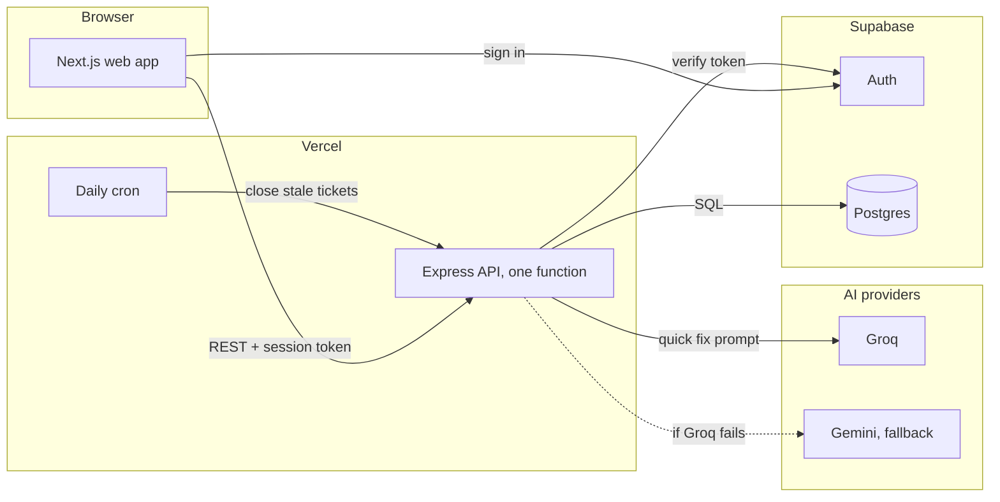
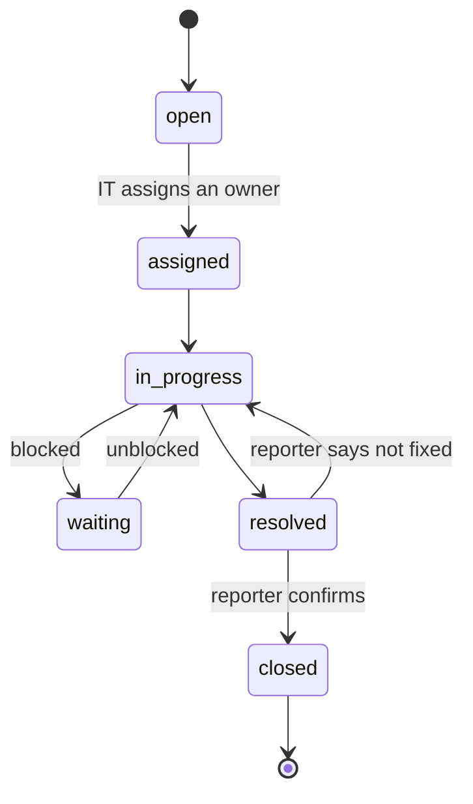

# Architecture

1. The user signs in through Supabase Auth and the web app receives a session token.
2. The web app calls the API with that token.
3. The API verifies the token, loads the user's role from `profiles`, and applies role and ownership rules.
4. The API reads and writes Postgres. Changes to a ticket and its activity trail happen in one transaction.
5. The optional quick fix sends the problem text to Groq, or Gemini if Groq fails, and stores the answer before a ticket exists.
6. Once a day Vercel Cron calls the API to close tickets left resolved for 3 days.

## Layout

| Path              | Holds                                                                     |
| ----------------- | ------------------------------------------------------------------------- |
| `apps/web`        | Next.js frontend: sign-in, tickets, quick fix, devices, people            |
| `apps/server`     | Express API: `features/<name>/router.ts` for routes, `logic.ts` for rules |
| `packages/shared` | Validation schemas and vocabulary used by both apps                       |
| `supabase/`       | Migrations, seed data and local Supabase config (`pnpm db:reset`)         |
| `docs/decisions`  | Why each major choice was made                                            |

## Ticket lifecycle

## Rules and where they live

| Rule                                                         | Enforced by                                                                                 |
| ------------------------------------------------------------ | ------------------------------------------------------------------------------------------- |
| Employees see only their own tickets and devices             | the SQL of every query (`reporter_id` / holder), so a stranger's record looks missing (404) |
| Roles: employee, IT staff, administrator                     | `requireRole` middleware, with the role read from the database on every request             |
| One holder per device, one pending change request per device | partial unique indexes                                                                      |
| A resolved or closed ticket says what fixed it               | check constraint, plus a 422 from the API                                                   |
| The activity trail is never edited                           | a trigger that refuses updates on `ticket_events`                                           |
| Due times follow priority                                    | a trigger on insert and on priority change                                                  |
| Two people cannot act on the same ticket or request at once  | `select ... for update` inside a transaction                                                |
| The demo administrator changes nothing                       | `requireUser`, from `profiles.is_demo` (ADR 013)                                            |

## Tests

- `apps/server/tests`: the API over HTTP against a real Postgres built from the migrations (57 tests).
- `apps/web/e2e`: Playwright runs the three critical flows (file a request; assign, resolve and confirm; approve a device change) against a local Supabase stack in CI.
- `apps/server/evals`: the quick fix against 47 labelled cases; results are committed per run.
